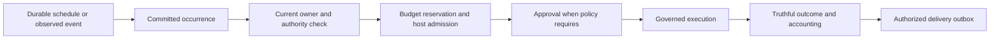

# ANALYSIS: dot-feature-support

Date: 2026-10-11 (America/Chicago)
Stage: Analyze. Source baseline: main 2cc9a1829167411e01a8198072f60892d70a233d.
Inputs: assessment.md, handoffs/assess.handoff.json, goals.md, versions.toml, current source and bounded primary-source research.
Output purpose: architectural choices and evidence for Plan, not product implementation or certification.

## Recommendation

Extend UAR's existing host-governed runtime. Keep identity, durable work, approvals, receipts and budgets in UAR's current persistence boundaries. Evaluate tokio-cron-scheduler 0.15.1 as a narrow timing adapter; do not make its job store authoritative. Retain Apalis and Temporal as reference alternatives instead of installing another execution system now.

The target remains the user's six capabilities: memory, proactive follow-ups, scheduled work, connected tools, approvals and recovery. The operator explicitly selected **local operation and shared hosting equally from the first release**. This supersedes the earlier provisional local-first assumption. Both deployment profiles are required release gates; shared-host execution is not deferred. Neither is currently certified. Exact supported client surfaces remain to be specified; this deployment choice does not silently promise every mobile or embedded SDK surface.

The uncomfortable thing: retaining UAR's own persistence means owning transaction and recovery correctness across backends. Adding a scheduler library will not provide that correctness. The alternative of adopting a workflow platform may reduce some orchestration work, but still leaves UAR-specific authority, approvals, memory isolation and uncertain external effects to integrate.

## Changes to the assessment baseline

### Container publication succeeded

[Run 38154340213](https://github.com/Prometheus-AGS/universal-agent-runtime/actions/runs/38154340213) completed successfully for both linux/amd64 and linux/arm64 and merged the manifest. The merge-job inspection logged:

| Object | Immutable digest |
|---|---|
| OCI image index | sha256:e955789aa6aea70853d4e19ce95b5c5774750d232472c048bd4763c96e5513f5 |
| linux/amd64 image manifest | sha256:29a66c9c9ad136d5bf01886cb07334c37ae90b52ee883169de81423e21823776 |
| linux/arm64 image manifest | sha256:6b7eb727db9f7d1d67eaa473eaffe140858224d7fa26917e122f4bfabf8f7dbe |

Repository: ghcr.io/prometheus-ags/universal-agent-runtime. The unknown/unknown attestation entries and Actions artifact checksums are not architecture image digests. This is publication-log evidence, not a fresh registry pull or deployed health check. R1 no longer warrants repeating the landed lockfile/schema/build-order repairs. Deployment health and reproducibility/pin reconciliation remain open.

### Effective dependency source inputs are identified

| Dependency/resource | Declared policy in versions.toml | Effective checked-in input |
|---|---|---|
| Liter | version 1.18.2, revision c5c6caac617eb931cd5009146a70831422ec236c | Cargo.toml:587 path vendor/git/liter-llm/crates/liter-llm; gitlink a6047386cc9fae4258b4a8577f6a016022095586; manifest and Cargo.lock version 2.1.1, no registry source |
| surreal-memory | server revision 432eaa1ebbef66fc02b9bb1a1e63cc2fdb2149e8 | Cargo.toml:422 path dependency; Cargo.lock version 0.1.0; ordinary committed vendor tree f9215a067a0e5dd3be0569ab687272c264748d5b, not a submodule at that historical revision |
| Builtin skills | revision ad5c82c6c16145637c589a3ddfa06e0f20d603e7 | gitlink f4bef4556a83ac22bf204bf69a01ddf0f9e007f2; excluded Cargo workspace, copied/loaded as skill resources; runtime environment/cache/sibling overrides can select another pack |

Docker copies the checkout, and the deployment checkout script initializes recorded submodule revisions. The Docker Rust build does not currently request --locked, unlike the native build command. Thus source dependency selection is known statically, but this analysis does not prove the full transitive dependency graph inside the published image. Local submodule status was clean for Liter and skills.

versions.toml remains policy authority. Identifying actual inputs does not approve the divergence. Plan must reconcile the manifest and intended revisions explicitly, retain immutable lockfiles and capture effective skill provenance; no pins were edited during Analyze.

### R4 is narrowed against the actual Liter source

At a6047386, Liter's src/http/streaming.rs:288–437 buffers lines and split UTF-8 and reports leftover-buffer EOF errors. It already has framing protection; do not rebuild that wholesale. When buffers are empty, EOF can return None without a terminal marker. UAR src/llm/liter_driver.rs:600 and :751 still gate terminal checking on endpoint_profile, and the legacy orchestrator route passes false.

The separate UAR Anthropic path remains selected for anthropic when its native flag is enabled (default true), and decodes chunks independently. Therefore the root boundary and native parser findings survive source revalidation at the effective input. No claim is made that every Liter provider route exhibits the same failure; wire-level production-path tests remain required. Full artifact dependency attestation remains outstanding.

## Build versus adopt decisions

Machine-readable verdicts are in library-candidates.json. “Adapt” is a researched recommendation with listed entry conditions, not authorization to add a dependency in this stage.

| Candidate | Verdict | Why |
|---|---|---|
| cand-001: UAR observers/admission/approvals/team catalog | Adapt | Existing durability and host-authority primitives match the domain. Add schedule occurrences and follow-up delivery through them. |
| cand-002: tokio-cron-scheduler 0.15.1 | Adapt, conditional | Provides timing and timezone APIs. Keep durable schedule/occurrence state in UAR. Exact-version DST, cancellation and restart fit must pass before adoption. |
| cand-003: Apalis 0.7.4 | Reference | SQL/Redis job patterns are useful, but a SurrealDB adapter and atomic integration with UAR records are not established. Stock retries cannot settle unknown effects. |
| cand-004: Temporal Rust SDK 1.1.0 | Reference | A viable shared-host orchestration comparison, but adoption must also preserve first-release local operation and coherent UAR authority/state. Equal priority does not itself require a second orchestration platform. |
| cand-005: existing MemoryService | Adapt | Keep current storage/retrieval; fix owner scoping, consent, deletion and source provenance across surfaces. |
| cand-006: UAR persistence/outbox/settlement | Adapt | Domain transactions must commit UAR work and evidence together. A generic queue cannot supply the ownership contract. |
| cand-007: pinned Liter framing | Reference | Reuse known framing behavior, retaining provider-specific event semantics and explicit terminal evidence. |

External evidence: [tagged scheduler README](https://github.com/mvniekerk/tokio-cron-scheduler/blob/v0.15.1/README.md), [Apalis stable README](https://github.com/apalis-dev/apalis/blob/v0.7.4/README.md), [current Temporal SDK README](https://github.com/temporalio/sdk-rust/blob/main/crates/sdk/README.md), and linked registry snapshots in the candidate file.

Maintenance checks found scheduler 0.15.1 released 2025-10-28, Apalis stable 0.7.4 plus newer 1.0 prerelease, and Temporal SDK 1.1.0 released 2026-10-06. Recency/download counts do not certify correctness. Context7's Temporal preview description is stale relative to current primary docs; it is excluded from the decision. Apalis main-branch examples are not accepted as stable-version API evidence. Temporal's registry license is non-standard and remains unresolved; this phase does not adopt it.

No new dependency is required to repair R2, R3, R5, R6, R7, R8 or R9. Those are UAR integration and ownership defects. The bounded research did not establish a drop-in framework satisfying both current persistence backends and all host-governance requirements.

## Proposed architecture contracts for Plan

Names below describe records and boundaries, not invented existing APIs.

**Identity is shared by every durable record.** Reuse verified issuer provenance already present in src/uar/security/claims.rs:57–75. ActorOwner currently preserves tenant/subject, not issuer; a new complete key must be derived only by the host from verified identity. Namespace local principals explicitly when no issuer exists; never silently equate missing issuer with another issuer. Choose one unambiguous versioned encoding and migrate credential and memory keys with provenance. Legacy records lacking ownership proof remain quarantined or require authenticated operator mapping. Do not assign them to the first matching subject. Preserve existing API-key authority metadata.

**Scheduling persists intent and occurrences.** Store owner, target, schedule definition, timezone, revision, pause/cancel state and cursor. Persist each due occurrence under a unique identity containing schedule/revision and intended UTC instant. A timer merely wakes scanning. Transactional compare-and-set must arbitrate concurrent scanners and commit cursor plus occurrence atomically. Restart recreates timing subscriptions from durable intent, not stored futures.

Proposed first-release semantics: one-shot plus recurring schedules; record skipped/late occurrences visibly, default recurring backlog to one coalesced admission after downtime, and prevent overlapping executions unless explicitly configured. Local times must retain an IANA timezone, with specified behavior for ambiguous/nonexistent DST times. These are proposals for Plan confirmation, not inferred user preferences. Do not expose unrestricted RRULE compatibility until a library and tests establish it.

cand-002 is accepted only if wrapping its timing layer actually reduces complexity and can preserve those semantics. Plan must include an exact-version fit decision before installing it; if it fails, return the timing choice to analysis rather than hand-write an unreviewed calendar parser.

**Proactive follow-ups are governed work.** Use existing durable observers for permitted source occurrences. Evaluate a stored, user-controlled rule under current context and authority; persist the decision and why a follow-up was suppressed or admitted. Quiet hours, destination permissions, opt-out and cancellation are checked before delivery. Approval follows existing effect policy, including external notifications where applicable. Revoke future work and queued delivery when authority changes.

Treat transport acknowledgement and human receipt separately. A sender timeout after dispatch is unknown unless the connector provides an idempotency/reconciliation contract. Do not label universal exactly-once delivery as achievable. Existing connector effect receipts remain the source of external-outcome evidence.

**Execution outcomes have explicit meaning.** Preserve raw MCP error content while mapping application failure separately from transport failure and unknown dispatch outcomes. Unknown effects never unlock workflow/team success dependencies or get replayed by generic retries. Streaming completion requires the terminal signal appropriate to the selected protocol; a socket closing or a syntactically complete last chunk is insufficient.

**Checkpoint recovery reconstructs authorized intent.** Load a durable owner-bound run/checkpoint envelope before requiring live manager state. Revalidate current authority, installed artifact/binding revisions, protected history and host resource references. Request host reattachment of secrets/resources without persisting secret values. Explicitly report unsupported backend capabilities rather than successful no-op storage. Pending approvals can become visible after restart, but execution resumes only after current binding and decision validity checks.

**Accepted uploads own recoverable bytes.** Prefer bytes and job metadata in one database transaction where feasible. If an external content store is used, durably write immutable content first, then atomically commit its reference and job in UAR; an unreferenced object may be collected, a committed reference may not. Idempotent document/chunk identities prevent duplicate indexing. No 202 before durable acceptance, including the no-worker case unless recovery can later discover and dispatch the committed job.

**Budget enforcement survives processes.** Keep current per-call charging and team reservations. Add stable settlement identity and durable reservation state with atomically enforced aggregate bounds; retries update the same settlement rather than append duplicate spend. Terminal completion must either await durable accounting acceptance or expose unresolved accounting as a separate state. Unknown spend remains reserved until reconciled. Do not change successful output into failure merely because accounting needs reconciliation.

**Supervisor fencing is an authority boundary.** Reuse existing non-expiring team claims and epoch checks. A privileged host/supervisor must establish that the old incarnation and its children cannot execute before replacing the epoch. Wall-clock lease expiry and a missing PID alone are insufficient. Local supervisor evidence and multi-host exclusion are different implementations; define supported profiles and refuse unsupported recovery. Transfer safe queued work only; preserve running/uncertain effects for reconciliation.

**Assistant memory is not just a vector index.** Existing MemoryService remains the engine. Enforce complete owner scope across legacy HTTP, MCP/native tools, prompt injection, update/delete/history and background capture. Add explicit retention/capture controls and provenance; retrieved text remains data, never grants authority. Deletion must cover retrieval indexes and durable records according to an explicit policy. Cross-tenant negative tests must include equal subjects and direct IDs.

## Priority and dependency reasoning

1. **Release and trust baseline:** finish pin policy/health evidence; complete principal isolation, API-key durability, truthful MCP outcomes and stream completion before advertising safe unattended execution.
2. **Restart and acceptance guarantees:** reconstruct checkpoints, atomically accept ingestion, settle/enforce budgets durably, and add supervisor fencing. These define what may safely resume.
3. **Assistant orchestration:** schedules, proactive rules/delivery and memory controls compose the foundations. Their contracts can be specified now; unattended activation depends on the relevant trust/recovery gates.
4. **Consumer reachability:** expose supported capabilities consistently to the chosen server/sidecar/embedded surfaces. Avoid assuming an HTTP method exists in embedded Runtime.

This is dependency reasoning, not a numbered implementation task plan. Every future change needs an OpenSpec delta. Extend existing local-scoped-observers, tool-approval-workflow and durable-team-execution contracts instead of creating competing meanings. Reconcile active cost-history/credential/run-scoped-resource changes before naming new ones.

The requested lifecycle is Assess → Analyze → Plan → Execute → Reflect. The installed orchestrator's separate Spec stage is optional; mandatory OpenSpec proposals/deltas remain part of Plan. No specifications or implementation tasks are authored by this analysis.

## Evidence required before acceptance

| Contract | Real production-boundary proof |
|---|---|
| Identity/memory/keys | Equal subject across tenants and issuers; create/read/delete/use denied across scope; migrate legacy records; restart and two-process revoke. |
| MCP/streaming | Real host admission and provider transport; application error, ambiguous timeout, arbitrary UTF-8/JSON splits and no terminal marker never become success. |
| Checkpoint/approval | Kill original process, restore with a fresh manager and real backend; pending approval survives visibly; changed bindings and unauthorized owner cannot execute. |
| Upload/accounting | Crash after durable acceptance and at indexing/settlement boundaries; recover one logical job/settlement; refuse when durable commit fails. |
| Schedule/follow-up | Two scanners, downtime, DST boundaries, pause/revoke and delivery timeout; one admission identity and truthful unknown outcome, with no repeated uncertain effect. |
| Team recovery | Old root/children excluded, new epoch accepted, stale worker denied; safe queued work transferred and uncertain work held. |

Run this locally through the shipped collaborators at the appropriate completed-work boundary. Unit/mock-only proofs and passing package builds are insufficient. Matrix: supported SurrealDB and Postgres configurations; in-memory mode must advertise that durable guarantees are unavailable. Native/embedded parity is not proven: the inspected HTTP Rust client has checkpoint/resume/upload methods, while the bounded embedded Runtime search did not find those names. Plan must define supported entry points, not widen scope silently to every mobile platform.

Both deployment profiles must pass before first-release acceptance. The local profile must prove fresh-process restart, durable work and approval recovery, and safe host-supervisor fencing. The shared-host profile must additionally prove identical-subject tenant/issuer isolation, at least two concurrent runtime processes, one logical schedule admission/settlement, cross-process key revocation and budget enforcement, and exclusion of a failed owner without replaying uncertain effects. The six capability contracts apply to both; passing one profile cannot substitute for the other. Plan must explicitly map each profile to its supported backends and entry points rather than assume local means SurrealDB or shared hosting means Postgres.

### Proposed deployment and entry-point support matrix

This is an architecture proposal for Plan, not a statement of current support. Both required profiles must ship together. Plan must accept or replace each proposed mapping before it can claim release coverage; an unresolved mapping blocks that claim.

| Deployment/profile | Proposed backend and entry points | Six-capability coverage and remaining gate |
|---|---|---|
| Local operation — required first release | Durable embedded SurrealKV, accessed through the governed local server/sidecar and its explicitly enumerated HTTP and MCP/native tool surfaces | Memory, proactive follow-ups, scheduling, connected tools, approvals and recovery are all required. Prove fresh-process recovery, authorization, durable acceptance/accounting and local supervisor fencing through each advertised surface. Current method coverage is incomplete/unverified. |
| Shared hosting — required first release | Networked SurrealDB with trusted durability attestation, shared by at least two runtime processes; authenticated server HTTP and MCP entry points | The same six capabilities are required. Additionally prove tenant/issuer separation, competing scanners, cross-process revocation/budget enforcement and supervisor exclusion. Attestation enables code paths; it is not proof of backend durability or safe multi-host operation. |
| Postgres alternative — mapping decision blocks any claim of equivalent support | Existing Postgres provider through server entry points | Plan must explicitly select and close parity gaps if advertising the six-capability assistant contract on Postgres. Otherwise identify that contract as unsupported on Postgres for this release, preserving existing unrelated behavior. Equal deployment priority alone does not authorize dropping existing Postgres functionality or silently promise parity. |
| Direct embedded Runtime SDK — unresolved surface | Backend and host-admission wiring to be specified | No six-capability parity claim. Plan must enumerate supported operations or explicitly exclude this entry point from assistant certification; topology support does not imply every SDK method exists. |
| In-memory or unattested remote storage | Development configurations | Excluded from durable assistant certification. Capability discovery must describe the missing guarantees explicitly. |

The SurrealDB proposal minimizes new storage integration: `src/uar/persistence/providers/surreal.rs:135–140` enables durable instances for `surrealkv://` or attested server endpoints; its observer capability at line 743 follows that flag. `PersistenceLayer::supports_durable_observers` defaults to false (`src/uar/persistence/mod.rs:98`), and the inspected Postgres provider has no override, although it does advertise durable approvals. These are source observations, not runtime validation or evidence that all six capabilities already work on SurrealDB. The uncomfortable consequence is that choosing Postgres for the required shared profile increases the parity work; choosing networked SurrealDB still requires real concurrency, isolation and failure evidence. Plan may change these backend recommendations while preserving both required deployment profiles and every advertised existing contract.

## Research scope, lessons and limits

Stack-specified mode: Rust/Tokio/Axum with current SurrealDB/Postgres persistence and existing frontend/domain architecture. No stack-recommendation.md is needed.

Budget: at most 8 retrieval queries per tier and 20 minutes; used tier 1=6 (three GitHub searches and three primary repository documents), tier 2=6 (three Context7 resolves and three queries), tier 3=3 registry queries, tier 4=0. In-document reads and local source/CI inspection are not new landscape queries. Broad comparison search was unnecessary. No benchmark, compatibility build or proof-of-concept was run; maintenance and API-fit confidence is bounded.

analyze-prior-context.md records direct scoped recall after the hook's helper failed. Applicable lessons:
- “reconcile effective build revisions before accepting dependency-sensitive findings” — addressed by source/lock/build-input tracing; actual image graph still unverified.
- “is it there on every surface a consumer reaches it through” — motivates explicit surface acceptance.
- “Retain the full owner, including tenant” — extends identity review to memory and background work.

Knowledge gaps: automatic historical inventory remains incomplete; no structured gap entries returned by fallback. Optional /learn-goal UAR durable scheduling and crash recovery remains a suggestion only.

Deployment priority is settled: both equally from the first release. Open choices for Plan: missed-run/overlap/DST defaults, destinations and latency, retention/capture consent, exact backend/entry-point support and supervisor implementations for both required profiles. No product release date or full Dot parity is promised.

## Verification and handoff

Tier 0 checks cover candidate-schema validity, evidence JSON, whitespace and artifact review only. No product code, new guards, dependency installation, build or runtime tests were added. Runtime findings remain source-level. Exact producer model is unavailable, so isolated review cannot claim verified cross-model independence.

Files: analysis.md; library-candidates.json; analysis-evidence.json; analyze-prior-context.md; appended decision-log.md and project session log; review/analyze/ and handoffs/analyze.handoff.json. The assessment remains a dated snapshot; updates are recorded here rather than rewriting its historical conclusions.

Next intended command: /kbd-plan dot-feature-support.

