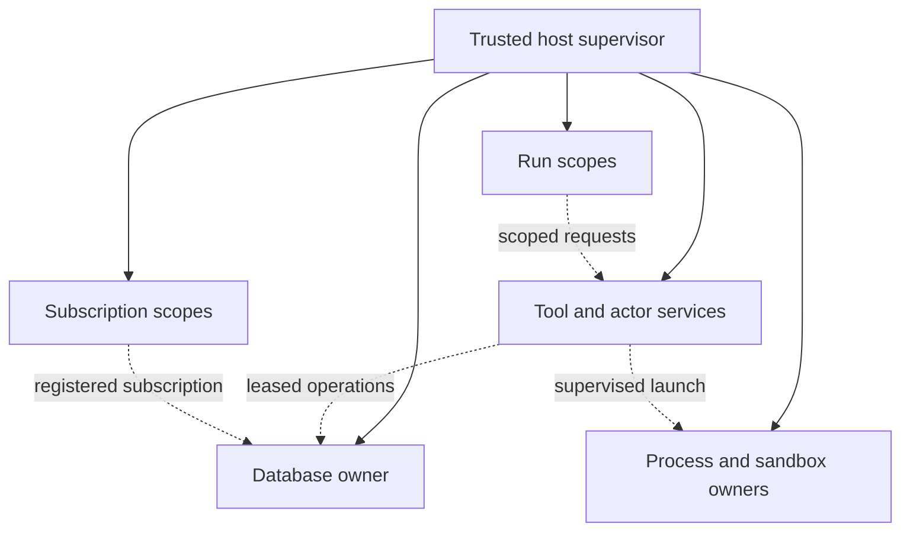
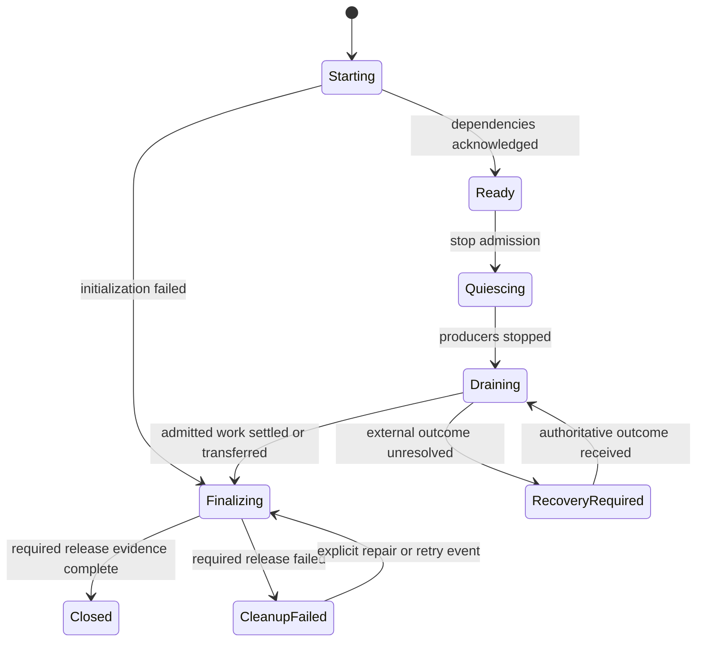

# Perfect Lifecycle Management Architecture

Event-driven ownership, completion, and recovery contracts for agentic applications.

**Status:** architecture proposal, not an implemented or verified capability.  
**Research date:** 2026-10-20.  
**Scope:** agent runtimes, embedded and remote databases, connection pools, transactions, subscriptions, model streams, tools, actors, subprocesses, sandboxes, and application/test shutdown.  
**Constraint:** no application-level polling or elapsed-time assumptions in the correctness path. No particular timeout duration establishes readiness, cancellation, termination, durability, or resource release.

This document was researched through Firecrawl web search and its developer index, with primary documentation and Context7 used to establish library contracts. It proposes a coherent design rather than claiming an exhaustive survey of every library. It does not change repository dependency pins, production code, phase state, or verification authorization.

## 1. The architectural decision

Use a **trusted host supervisor with acyclic ownership, structured task scopes, explicit resource leases, and acknowledged lifecycle transitions**.

Every resource has one lifecycle authority. Every task belongs to a scope. Every operation has a defined completion point. Every cancellation request has a separately observed outcome. Every durable mutation has an identity and a recoverable result. Resources close only after their dependents have finished using them.

Completion is established by an event whose contract proves the required fact:

- A task's joined outcome proves its execution ended.
- An adapter's close acknowledgement proves the specifically documented resource-release obligations.
- A transaction's confirmed commit proves the configured durability boundary was crossed.
- A child-process wait proves that particular process terminated and was reaped.
- A durable operation receipt proves the recorded business transition.

A signal requesting any of these actions is not the acknowledgement. A log message describing an intention is not an acknowledgement. A reference count, an empty task list observed momentarily, or an elapsed interval is not an acknowledgement.

The preferred solution is the smallest mechanism that establishes the necessary fact. A local scoped task does not need a distributed workflow engine. A shared database mutation cannot be made globally safe with a process-local mutex.

### The uncomfortable limit

“Perfect” means explicit safety and recovery contracts, not guaranteed finite completion in every environment.

A permanently silent remote server, an uninterruptible kernel operation, or a crashed machine may never produce a completion event. Removing timeouts does not create a failure detector. The FLP result establishes a relevant boundary: deterministic consensus cannot guarantee termination in a fully asynchronous system with even one possible crash. It is not a claim that every local cleanup is impossible. It means a design must not promise unconditional distributed progress without stating additional assumptions. [Fischer, Lynch, and Paterson](https://groups.csail.mit.edu/tds/papers/Lynch/jacm85.pdf)

This architecture preserves safety while progress is unresolved. It reports the pending dependency, waits for an authoritative event, or accepts an explicit operator cancellation/fencing action. It does not turn silence into “closed,” “rolled back,” or “safe to retry.”

No fixed-duration fallback is prescribed here. An independently configured platform deadline can terminate a deployment, but that event is an interruption, not successful graceful shutdown. Transport stacks, database engines, and consensus implementations may internally use timers; the application must not pretend those mechanisms are timer-free or use their expiry as proof of business completion.

## 2. What the observed failures establish

| Observation | Established mechanism or evidence limit | Required architectural contract |
| --- | --- | --- |
| Store-outage admission reached the outer HTTP timeout | A dependent operation did not produce a sufficiently early result; a historical timeout repair passed its follow-up | Admission depends on explicit resource state and scoped operations. Silence remains unresolved; a transport failure or declared unavailable state produces a typed rejection |
| PostgreSQL bootstrap/readiness ordering failed | Fixture startup order was corrected | Startup is a dependency graph with readiness acknowledgements |
| Configuration rewrite raced startup | A content-versioned fixture avoided the mutable-path race | Startup consumes one immutable configuration generation |
| Surreal `NONE` became the string `"None"` | The conversion defect was repaired and its targeted proof passed | Persistence adapters preserve absence, null, type, and error semantics |
| Concurrent credential migration returned 503 | Identical concurrent applies failed after sequential flows succeeded; exact database error was not retained | Durable idempotency and contention semantics belong to the persistence contract |
| Embedded-store shutdown retained its lock | Source contains a strong-reference cycle retaining persistence; test bodies passed but teardown failed | Acyclic ownership plus an actual datastore-close acknowledgement |
| Sidecar confinement test remained unfinished | A blocking watcher can outlive a panic because its stop signal occurs only on normal return; the exact triggering panic is absent | Scope-owned workers and cleanup that survives failure of the task body |

The strongest UAR ownership finding is:

```text
RunManager
  -> NativeSkillRegistry
  -> ScheduleTool
  -> ScheduleController
  -> AgentInstanceController
  -> RunManager

AgentInstanceController
  -> PersistenceLayer
  -> SurrealDbProvider
  -> database handle
```

These are strong ownership edges. Follow-up tools create an analogous path. The cycle exists at startup; it does not require a running schedule. Relevant source: [manager ownership](/Volumes/T7/Projects/prometheus/universal-agent-runtime/src/uar/runtime/manager.rs:620), [tool ownership](/Volumes/T7/Projects/prometheus/universal-agent-runtime/src/uar/runtime/native_skills/schedules.rs:8), [controller ownership](/Volumes/T7/Projects/prometheus/universal-agent-runtime/src/uar/runtime/schedules/controller.rs:14), [instance ownership](/Volumes/T7/Projects/prometheus/universal-agent-runtime/src/uar/runtime/instance/controller.rs:62), and [startup wiring](/Volumes/T7/Projects/prometheus/universal-agent-runtime/src/server.rs:1656).

For migration, the [concurrent fixture](/Volumes/T7/Projects/prometheus/universal-agent-runtime/scripts/release/uar_1_1_1_credentials.py:391), [transaction](/Volumes/T7/Projects/prometheus/universal-agent-runtime/src/uar/security/credentials/principal_store.rs:468), and [error mapping](/Volumes/T7/Projects/prometheus/universal-agent-runtime/src/uar/api/credentials.rs:101) support a contention-handling explanation, but do not recover the missing historical error. The current journal-reread fallback is later code, not proof of the original cause.

For the stall, the [watcher's stop ordering](/Volumes/T7/Projects/prometheus/universal-agent-runtime/tests/sidecar_launch_security/confinement.rs:111) and [panic-producing request helper](/Volumes/T7/Projects/prometheus/universal-agent-runtime/tests/support/sidecar_process.rs:712) establish a concrete hang mechanism. They do not establish which assertion failed.

Historical evidence: [Round 5 report](/Volumes/T7/Projects/prometheus/universal-agent-runtime/.kbd-orchestrator/phases/uar-outstanding-issues-v1-1-1/release-qualification-report-1.1.1-function-first-round5.md:69) and [c9 teardown/stall ledger](/Volumes/T7/Projects/prometheus/universal-agent-runtime/.kbd-orchestrator/phases/uar-outstanding-issues-v1-1-1/receipts/r-ledger-reconciliation-2026-10-19.md:2782).

## 3. Design alternatives and selection

| Approach | Appropriate use | Limitation | Decision |
| --- | --- | --- | --- |
| Lexical ownership and synchronous RAII | Memory, descriptors, guards, short-lived local resources | Cannot by itself await an asynchronous protocol or durable transaction outcome | Default foundation |
| Weak back-references | Navigation to an independently owned parent | Upgrading can fail; weak references do not establish shutdown order or task completion | Useful supporting technique |
| Supervisor plus scoped tasks and leases | Shared services, agent runs, asynchronous resources | Requires explicit admission and finalization protocols | Primary architecture |
| Resource-owning actor with narrow command ports | Serial state transitions and embedded stores | Mailbox ownership and request/reply waits can still form cycles | Use selectively with explicit stop and join |
| Dedicated helper process | SDKs or native libraries with no reliable close/cancel contract | IPC cost; process exit proves reclamation, not successful commit or flush | Preferred containment fallback |
| Durable operation journal and transactional arbitration | Concurrent mutation, restart, response loss | Must use the same atomic boundary as the mutation | Required for retryable durable effects |
| Durable workflow/coordinator | Multi-host, multi-step work that survives application shutdown | More machinery; external side effects still need idempotency or reconciliation | Use when scope actually requires it |
| Sleeps, repeated lock probes, periodic process scans | Approximate diagnostics | Cannot prove lifecycle completion | Excluded from the correctness path |
| Increasing timeout values | Operational accommodation | Changes when waiting stops without correcting ownership or completion | Not an architectural repair |

Structured concurrency provides the task-lifetime foundation: child tasks remain within an owning scope, and leaving the scope accounts for their completion. Trio's nursery model provides a clear reference. Tokio exposes building blocks rather than an automatic application-wide ownership discipline. [Trio tutorial](https://trio.readthedocs.io/en/stable/tutorial.html), [Tokio graceful shutdown](https://tokio.rs/tokio/topics/shutdown)

## 4. Ownership and authority

### 4.1 Separate ownership from access

The host supervisor owns services. Services expose narrow access capabilities. A tool receives permission to request an operation, not ownership of the complete runtime and its database.



Solid arrows mean ownership. Dotted arrows mean access through a governed interface. Access capabilities must not secretly retain the lifecycle owner.

For UAR, schedule and follow-up tools should invoke a host-owned instance service through a narrow port or a deliberately non-owning reference. That service is independently rooted in the supervisor. It must not be owned through a registry owned by the manager it calls.

Replacing every `Arc` with `Weak` is not the design. Strong ownership is correct from owner to dependent. Back-references and access capabilities must not close the ownership cycle.

### 4.2 Keep two graphs acyclic

Both of these graphs matter:

1. **Ownership graph:** who keeps whom alive.
2. **Wait/dependency graph:** who must finish before whom.

Acyclic references can still deadlock: a database actor waiting for a subscriber that is waiting for that actor to process unsubscribe is one example. Close subscribers while the database's control path remains available. Do not hold the coordinator lock while awaiting a child that needs the same lock.

A resource-owning actor must terminate on an explicit close command/state transition. Its own internal sender clone must not keep it alive merely because the receiver waits for all senders to disappear. Control requests must remain deliverable when the ordinary work queue is full.

### 4.3 Capability inversion remains intact

Agent kernels express intent. The trusted host admits work, owns resource leases, executes mutations, and records outcomes. Model-generated content cannot release a database, mint a resource lease, bypass admission, or declare its own effect completed.

Persistent lifecycle/business state belongs in inspectable host systems. It must not live only in a model conversation, a UI boolean, or an untracked task.

## 5. Lifecycle state and completion evidence

The following names are proposed architectural vocabulary, not existing repository APIs.



`CleanupFailed` retains ownership/accountability for unreleased resources. `RecoveryRequired` is not successful cancellation. A crash can interrupt any state and is handled by recovery, not a fictitious final transition.

Each resource record contains:

- Stable resource ID, instance generation, owner scope, and resource kind.
- Current state and monotonically increasing state revision.
- Dependencies and the scopes holding active leases.
- Admitted operations, subscriptions, and child tasks.
- Stop reason, primary outcome, cleanup outcomes, and unresolved obligations.
- The adapter contract and the evidence required to declare closure.

An in-memory record is sufficient for resources that disappear with the process. An operation with externally persistent effects needs a durable identity and recovery record. Do not persist meaningless memory addresses as recovery identities.

### 5.1 Close has one execution and many observers

Concurrent callers requesting close attach to one supervisor-owned finalization operation. They receive the same terminal report. A caller dropping its wait future does not cancel finalization.

A caller may supply a budget for observing that close operation. Budget expiry
returns `Pending` with the same shutdown identity and outstanding obligations;
it does not terminate cleanup or authorize dependency release. Accept and retain
the close request before any cancelable wait, including registry acquisition.
An unavailable inventory is reported explicitly, never as an empty clean result.
UAR's opt-in host API is documented in
[budgeted shutdown observation](operations/lifecycle-budgeted-shutdown.md).

The resource generation cannot reopen after reaching `Closed`. A restart creates a new generation, so a delayed event from the previous instance cannot close, authorize, or mark ready the replacement.

The completion report distinguishes:

| Dimension | Example |
| --- | --- |
| Local reclamation | All local connections and storage handles released |
| Protocol completion | Peer acknowledged unsubscribe or session termination |
| Business outcome | Migration committed, rolled back, or still unknown |
| Durability | Commit acknowledged under the configured storage policy |
| Continuation ownership | Durable work transferred to a named accepting supervisor |

A remote connection may be locally closed while its last transaction outcome remains unknown. A killed helper process may have released file descriptors without completing a graceful flush. These facts must not be collapsed into one success boolean.

### 5.2 Safety and progress claims

The architecture requires:

- No newly admitted operation after the relevant admission gate closes.
- Every admitted operation is registered before it can produce effects.
- No dependency closes while a dependent still has a valid lease requiring it.
- No scope reports completed while owned children or finalization obligations remain.
- No receipt claims a durable effect without the appropriate commit evidence.
- No uncertain external effect is retried as though known absent.

Progress is conditional on scheduled tasks running, required peers responding, and adapters honoring their contracts. A claim of unconditional progress must not be substituted for these assumptions.

## 6. Admission, task scopes, and cancellation

### 6.1 Make admission atomic with registration

Checking `Ready`, then spawning, then recording a task is unsafe. Shutdown can occur between those actions and miss the task.

The lifecycle authority must atomically:

1. Confirm that the scope permits the operation.
2. Allocate its operation identity and resource lease.
3. Register its completion obligation.
4. Transfer that registered obligation into execution.

Failure to launch must release the registration. The shutdown transition uses the same serialization boundary. Existing admitted work may create necessary child work only through a still-live registered parent; that transfer cannot expose a false “zero outstanding work” state.

New external work is rejected during quiescence. Previously admitted work retains the narrow capabilities needed to commit, roll back, acknowledge, or transfer ownership. A global “everything cancelled” flag must not disable those finalizers.

### 6.2 Cancellation is a request with an outcome

Use distinct concepts:

- **Stop requested:** the owner asks the operation to stop.
- **Stop observed:** execution reaches a safe cancellation point.
- **Operation settled:** effects are committed, rolled back, transferred, or recorded as unresolved.
- **Cleanup completed:** owned resources have produced the required release evidence.

Cancellation of a response stream does not prove a model provider stopped generating. Dropping a query future does not prove the database rolled back. Cancellation of a tool request does not prove its subprocess or external side effect stopped.

Task cancellation and task joining are separate. Tokio documents this distinction in its shutdown guidance. Its task tracker waits for tracked tasks to exit, but `TaskTracker::close()` does **not** prevent additional task registration; an application admission gate is still required. A tracker also does not replace collection of each task's success, error, or panic outcome. [Tokio shutdown](https://tokio.rs/tokio/topics/shutdown), [TaskTracker contract](https://docs.rs/tokio-util/latest/tokio_util/task/struct.TaskTracker.html)

### 6.3 Cleanup must survive body failure

The owner outside the task body retains the task handle and cleanup obligation. If the body returns an error, panics, or its caller disappears, that owner still:

1. Records the original outcome.
2. Requests cancellation of remaining children.
3. Runs finalizers using their own permitted control paths.
4. Joins children and collects cleanup outcomes.
5. Publishes the combined result without overwriting the original failure.

A synchronous destructor can revoke a lease or signal an already-existing supervisor. It cannot promise that asynchronous cleanup has completed. Do not spawn essential cleanup from a destructor after the executor is already shutting down. Tokio has documented a related boundary: blocking work submitted during runtime shutdown may never start. [Tokio issue 7499 and linked clarification](https://github.com/tokio-rs/tokio/issues/7499)

Finalizers are protected from cancellation of the ordinary request body, but are not assumed infallible. Their own failure remains observable. A process abort, forced termination, or machine failure bypasses ordinary unwinding and requires crash recovery.

### 6.4 Blocking operations

Use readiness-driven asynchronous I/O where supported. A long-lived worker that is fundamentally blocking needs a wakeable command channel, pipe, event object, or documented interrupt mechanism. It must not repeatedly read an atomic flag and sleep.

If a native operation cannot be interrupted and may never return, isolate it in a supervised process when reclamation is required. Moving it to `spawn_blocking` does not make it cancellable. Started blocking tasks can keep runtime shutdown waiting; abandoning their handles does not stop them. [Tokio `spawn_blocking`](https://docs.rs/tokio/1.49.0/tokio/task/fn.spawn_blocking.html), [Tokio clarification](https://github.com/tokio-rs/tokio/pull/7501)

## 7. Event delivery without polling or lost wakeups

“Event-driven” here means parking until an authoritative event or readiness signal arrives. It does not prohibit the runtime's `Future::poll` machinery or an OS readiness primitive named `poll`. It prohibits periodic application-level sampling used to guess completion.

| Replace | With |
| --- | --- |
| Sleep, then assume startup completed | A generation-bound readiness result from initialization |
| Repeatedly inspect a lock file | Datastore-close acknowledgement, or verified owner-process termination |
| Periodically scan a process tree | Registered process handles, launch events, and termination waits |
| Spin on an active-operation count | Lease-release notifications and an atomic drain predicate |
| Repeatedly query a migration journal | Transaction arbitration, shared local completion, or a durable completion stream |
| Poll for approval | A durable approval transition delivered to the waiting scope |
| Retry connection on a fixed interval | Explicit reconnect/availability/operator events; unresolved state if none exists |

### 7.1 State is authoritative; notifications wake readers

A bare notification can be missed between checking state and beginning to wait. Use a primitive that atomically registers interest with observing the predicate, or a retained state/version channel whose current value is available to late subscribers.

For example, closure observers wait for a specific resource generation's retained terminal result. They do not depend on catching one transient `closed` broadcast.

Checking a predicate after an event is not polling. Repeatedly checking it on a timer is.

### 7.2 Remote streams need reconnect and replay semantics

For a durable stream:

1. Establish a subscription at an acknowledged cursor or generation.
2. Load the authoritative snapshot using the stream's documented snapshot/cursor boundary.
3. Apply subsequent events, rejecting stale generations and deduplicating stable IDs.
4. On disconnect, invalidate continuity; reconnect and replay or resnapshot before resuming dependent operations.

If the transport has no replay or reliable gap detection, it cannot serve as the sole correctness channel. Use it only as a wakeup hint around authoritative state.

PostgreSQL explicitly documents the initial `LISTEN` race: commit the subscription first, inspect state in a new transaction, then process subsequent notifications. Notifications become deliverable at commit and can be coalesced. Use a session-stable connection for a session-scoped listener; ordinary pooled query leases are not interchangeable with a listener session. [PostgreSQL LISTEN](https://www.postgresql.org/docs/current/sql-listen.html), [PostgreSQL NOTIFY](https://www.postgresql.org/docs/current/sql-notify.html)

For crash-resilient cross-service delivery, write an outbox record atomically with the business change and stream it through a log-based change feed with retained offsets. Do not use a periodically scanned outbox as the event-driven solution. A CDC architecture still depends on its documented recovery, retention, and delivery guarantees; the transformation alone does not establish exactly-once effects. [Debezium outbox event router](https://debezium.io/documentation/reference/stable/transformations/outbox-event-router.html)

No design may silently add a polling fallback when event continuity is unavailable. Report the capability gap.

## 8. Database lifecycle contracts across backend types

### 8.1 A universal contract, with backend-specific evidence

Do not pretend all databases have the same close operation. Require every adapter to declare:

| Capability | Required declaration |
| --- | --- |
| Ownership boundary | Which object/process owns sockets, engine tasks, files, and locks |
| Acquisition | What acknowledgement means a session or transaction is usable |
| Admission | How new operations are rejected once quiescence begins |
| Operation cancellation | Whether cancellation is supported and what it proves |
| Transaction outcome | How commit, rollback, and unknown outcome are distinguished |
| Subscription termination | Required identity, session context, acknowledgement, and stream completion |
| Close completion | Exact handles/tasks released before close resolves |
| Crash recovery | How durable operations and ownership generations are reconciled |
| Durability | Meaning of a commit acknowledgement for this backend/configuration |
| Unsupported guarantees | Which obligations cannot be proven with the selected driver |

An adapter that cannot establish mandatory completion evidence must be rejected for that deployment profile or placed behind an owner boundary that can. It must not advertise graceful closure based on a sleep or last-client drop.

### 8.2 Connection pools: PostgreSQL, MySQL, and similar SQL services

The application scope owns the pool. Request scopes borrow tracked connections. Transactions, cursors, streaming results, and prepared resources are explicit dependents.

The shutdown sequence is:

1. Stop new business operations at the host admission boundary.
2. Stop producers and allow admitted work to settle or transfer.
3. Finish or explicitly roll back transactions while the connection is usable.
4. Finish cursors and result streams; release checked-out connections.
5. Invoke and await the pool's documented closure operation.
6. Account for any separately owned driver tasks and dedicated listener sessions.

Do not close the pool before finalizers that still need to acquire a connection. Define a separate closing signal for long-lived queries so they can return their leases. If local cancellation cannot establish remote transaction outcome, mark that outcome unresolved before releasing local resources.

SQLx 0.8.6 provides a useful adapter model: `Pool::close().await` waits for its connections to close, including checked-out connections when returned; `close_event` announces the initiation of closure. The latter is not completion evidence. Dropping the last pool reference alone is a weaker lifecycle boundary. [SQLx 0.8.6 Pool](https://docs.rs/sqlx/0.8.6/sqlx/struct.Pool.html)

Pool closure establishes the driver's documented local/protocol obligations. It is not a universal assertion that every remote server resource has already been reclaimed, nor that a previously interrupted commit failed.

### 8.3 Embedded engines: SurrealKV, RocksDB-style stores, SQLite

The owner holds the engine, all client capabilities, maintenance tasks, subscriptions, and storage handles. A completed engine close must include the configured flush/durability actions, maintenance-task termination, and file/lock release required for safe reuse.

A synchronous drop initiating detached shutdown is not that contract. The upstream SurrealDB report describes immediate reopen failures after client drop and requests an awaitable shutdown. The issue was marked closed when researched; the retrieved page did not identify a release or linked implementation establishing that UAR's pinned 3.3.0 has the required public contract. No upgrade or API availability is assumed here. [SurrealDB issue 7307](https://github.com/surrealdb/surrealdb/issues/7307)

There are three legitimate choices:

1. Use an existing documented engine-close acknowledgement if the selected version exposes one.
2. Add or adopt an upstream lifecycle API that actually joins shutdown and reports release errors, under the project's dependency-change process.
3. Run the engine in a dedicated process with exclusive ownership of its local handles, and supervise both its graceful protocol and termination.

An outer Rust wrapper cannot manufacture missing internal completion evidence by watching a counter or dropping an `Arc`.

For process isolation, termination must cover every process that could inherit or hold database handles; descriptor inheritance is restricted. OS termination/reaping establishes process-local reclamation under that platform's contract. It does not prove a graceful database flush. Abnormal exit requires the engine's documented crash-recovery path before readiness is announced.

SQLite illustrates why subordinate resources belong in the contract: `sqlite3_close` can return busy with unfinished statements or other handles; `sqlite3_close_v2` can return success while deferring deallocation of a “zombie” connection. Finalize statements, BLOB handles, and backups before claiming release. [SQLite close contract](https://www.sqlite.org/c3ref/close.html), [related CPython issue](https://github.com/python/cpython/issues/135117)

Never delete a database lock file to simulate releasing the lock. Do not use successful lock acquisition as a substitute for accountable engine shutdown. A later reopen belongs to a new initialization operation after closure evidence, not to a retry loop that guesses when old ownership disappeared.

### 8.4 Remote document, graph, key-value, vector, and analytics stores

Apply the same capability contract to each actual driver:

- A client may own a connection pool, topology monitor, retry worker, change stream, or HTTP transport.
- A result cursor, change stream, session, and transaction may each require separate completion.
- Local transport closure and server-side operation completion are separate dimensions.
- A stateless HTTP facade can still leave an asynchronously executing job on the server.
- Server jobs require a durable job ID and completion/cancellation acknowledgement or a recorded unresolved outcome.

Do not infer close or cancellation behavior from the product category. Redis, MongoDB, a graph store, and a vector service do not acquire equivalent lifecycle contracts merely by implementing one application trait.

### 8.5 In-memory stores and test doubles

In-memory storage still owns tasks, streams, callbacks, and leases. Its data may disappear on drop, but that does not excuse detached workers or unobserved failures.

A test double must model the same admission, closure, and outcome distinctions as the real adapter. An immediate successful `close` stub cannot certify an embedded engine's file release.

## 9. Correct concurrent migration without sleeps or journal polling

### 9.1 Define the durable identity

Use a tenant-bound logical operation key plus a canonical request fingerprint containing the source identity/revision, destination identity, approved mapping, and relevant preconditions. The exact key encoding is a design decision, not a proposed new repository field.

The durable journal must bind that identity to one immutable outcome:

- Same logical identity and compatible request: replay the existing result.
- Same identity with incompatible mapping or preconditions: typed rejection.
- Authoritatively absent result and permission to execute: perform the mutation.
- Uncertain commit or unresolved predecessor: retain `OutcomeUnknown` and reconcile.

Reauthorize the caller before returning a receipt. An idempotency key does not confer access to another tenant's result. The first committed receipt supplies generated fields; subsequent attempts do not invent replacement receipt IDs or completion timestamps.

### 9.2 Serialize at the actual contention boundary

**Single-host embedded store:** route migrations for the same key through the resource-owning service. Queue duplicates behind the admitted operation and share its terminal result. The durable transaction and journal still protect restart and response loss. All writers that can affect the invariant must participate in the same boundary.

**Shared SQL database:** use database-backed arbitration, such as a transaction-scoped advisory lock or a stable guard row, followed by an authoritative journal read and the mutation in one transaction. An absent journal row cannot itself be locked with a row lock; choose an arbitration object that exists independently of the row being created.

PostgreSQL transaction-level advisory locks release with transaction completion, unlike session-level locks. Under `READ COMMITTED`, perform the journal read in a subsequent statement after acquiring the lock so it observes commits that occurred while waiting. Do not reuse a snapshot acquired before the wait. With stronger snapshot isolation, handle its documented full-transaction restart semantics. Acquire multiple arbitration keys in a consistent order. [PostgreSQL explicit locking](https://www.postgresql.org/docs/current/explicit-locking.html), [transaction isolation](https://www.postgresql.org/docs/current/transaction-iso.html)

**Shared backend without suitable arbitration:** use a durable single-writer/coordinator partition for the key, with storage-enforced fencing and atomic mutation/journal support. A process-local mutex is insufficient. If neither backend transactions nor an equivalent atomic command can protect the invariant, the profile cannot promise atomic migration; it needs a different backend or an explicitly recoverable multi-step protocol.

All variants retain database uniqueness constraints. Coordination reduces races; constraints remain the final protection against invariant violations.

### 9.3 One transaction records both effect and receipt

For an admitted new operation:

1. Acquire the authoritative arbitration right.
2. Read the journal and revalidate authorization and preconditions.
3. If a matching receipt exists, return that receipt.
4. Otherwise validate the source and destination.
5. Create the destination and immutable journal receipt atomically.
6. Commit.
7. Publish completion to waiters only after commit confirmation.

Only the authoritative outcome may wake waiters as successful. An in-memory “started” entry must not become an indefinite promise if its owner panics. The supervisor completes that entry with a known failure or unresolved outcome, and durable recovery takes over where necessary.

### 9.4 Conflict and uncertainty are different

Preserve backend error categories. Do not parse every error into a generic 503 or reinterpret every database failure as a harmless duplicate.

| Outcome | Required action |
| --- | --- |
| Confirmed competing identical commit | Read under the arbitration contract and replay the committed receipt |
| Mapping or precondition mismatch | Return the corresponding typed rejection |
| Confirmed transaction abort due to serialization/conflict | Re-enter the serialized operation or perform the documented transaction restart |
| Storage unavailable before execution | Reject with a typed availability error |
| Connection lost while commit may have executed | Record unknown outcome; reconcile by the same durable operation identity |
| Malformed receipt or violated invariant | Surface a typed integrity failure; do not retry blindly |

A restart after a definite transaction-abort event is not timer polling. Repeatedly rereading an absent journal until it happens to appear is. The preferred design prevents same-key local contention and waits for database arbitration rather than relying on a hot retry loop.

If the winner is remote and its outcome remains unresolved, subscribe to a durable completion channel or wait for an authoritative reconciliation event. No fixed retry delay makes an uncertain commit safe to repeat.

## 10. Subscriptions, streams, and session context

Treat a subscription as a resource, not as a loop that happens to read events.

Its record includes the backend identity, namespace/database, authenticated session context, subscription ID, generation, stream cursor where supported, and terminal outcome.

Closure must:

1. Close the subscription's creation/reconnect admission.
2. Prevent its supervisor from opening a replacement.
3. Request unsubscribe using the correct owning session/context.
4. Observe the backend acknowledgement according to its protocol.
5. Settle buffered delivery according to an explicit drain-or-discard policy.
6. Join the reader and release its database lease.

Steps 3–6 must follow the driver's actual progress dependencies. If the acknowledgement is delivered through the same reader, keep that reader running until the acknowledgement is processed. Do not join it first and deadlock the protocol.

A connection loss may end local reading without proving remote unsubscribe. Record that distinction and use session termination or reconciliation where the backend supports it.

The UAR live-query namespace warning reinforces the need to retain cleanup context, not just an ID. The source-level session finding is not treated here as an independently confirmed upstream fix. The separate strong-reference cycle must also be removed; successful unsubscribe does not release a database still owned elsewhere.

Table-wide `INFO`/`KILL` sweeps are not the normal ownership model. A shared service must never destroy other subscribers' resources to compensate for missing local accounting.

## 11. Agentic work, subprocesses, and sandboxes

### 11.1 Run scopes include effects, not only model futures

An agent run owns:

- Provider requests and response streams.
- Tool invocations and pending approvals.
- Actor messages and child runs.
- Subprocesses, terminals, and sandbox sessions.
- Durable operation identities and terminal-event publication obligations.

Each child has a terminal outcome. Model completion alone does not complete the run if a tool or persistence obligation is still outstanding.

Human approval is a durable waiting state. It does not hold a database transaction or pool lease open. Shutdown either records cancellation of the pending action or transfers its durable continuation to an acknowledged owner.

Long-running work that intentionally survives a request must move to a separately owned durable scope. It must never survive accidentally because a task was detached. That transfer has an explicit acceptance acknowledgement and stable operation identity.

For WASM, CPU loops, GPU/native work, and model engines, define the available safe points or interruption primitives. An instruction budget or explicit cooperative checkpoint can be independent of wall-clock speed, but is not a substitute for resource finalization. Uninterruptible native work belongs behind an appropriate process boundary.

### 11.2 Launch and readiness are a protocol

The parent registers the child and its termination observer before allowing untracked work to escape. The child reports:

- Instance generation and configuration identity.
- Initialization success or a typed startup error.
- The exact service boundary now ready.

Receiving a listening port or a log line does not prove schema bootstrap, credential policy, subscriptions, or required collaborators are ready.

The child receives immutable configuration content or a content-addressed, atomically published artifact. Both parent and child bind readiness to that generation. Startup never races another writer modifying the same config file.

### 11.3 Process exit requires a process wait

Own process handles and await termination. Sending a signal, closing stdin, or receiving an EOF is not proof that every child exited.

Linux provides process-descriptor readiness and `waitid`/`waitpid` semantics; macOS exposes process events through dispatch sources; Windows offers process grouping through Job Objects. These are platform building blocks, not interchangeable proofs. Observe termination through the documented process-wait boundary, prevent handle inheritance and descendant escape where required, and account for all owned descendants. [Linux process descriptors](https://man7.org/linux/man-pages/man2/pidfd_open.2.html), [Linux waits](https://man7.org/linux/man-pages/man2/wait.2.html), [Apple dispatch sources](https://developer.apple.com/library/archive/documentation/General/Conceptual/ConcurrencyProgrammingGuide/GCDWorkQueues/GCDWorkQueues.html), [Windows Job Objects](https://learn.microsoft.com/en-us/windows/win32/procthread/job-objects)

Windows specifically cautions that most job completion-port messages are not guaranteed to arrive. Do not make one such notification the sole proof that all descendants are gone. Use documented waits and ownership restrictions; if an adapter cannot establish the required descendant-completion barrier, report that limitation instead of falling back to periodic scans.

### 11.4 Replace the confinement test's observer architecture

The current watcher polls the process table and depends on a normal return before setting its stop flag. The replacement design has two responsibilities:

1. **Lifecycle correctness:** the parent supervisor owns the run body and all observers. Failure of the body triggers observer cancellation and joining before the final failure is reported.
2. **Security evidence:** the launcher records the actual child creation and provides a handshake allowing inspection before the child continues. A probe reports its inherited environment over a pipe, then waits for an explicit release event.

A controlled probe demonstrates the tested launch path. It does not prove that arbitrary untrusted grandchildren cannot escape supervision. That stronger claim requires OS containment/event facilities with adequate coverage; if the platform cannot provide them, the test must report the limitation.

Assertions run after cleanup where practical. When assertions must occur during execution, their failure must be observed by the external scope owner. No observer's shutdown depends on executing the next line after a potentially panicking await.

## 12. Startup and shutdown ordering

### 12.1 Startup

Start dependencies before dependents. Record every acquired resource immediately so partial startup can unwind the successfully initialized prefix.

For an agent service, the usual ordering is:

1. Parse and bind an immutable configuration generation.
2. Establish the persistence owner and its actual readiness.
3. Complete required schema/bootstrap work.
4. Establish credential and policy services.
5. Start supervised subscriptions, actor services, and effect executors.
6. Publish the application generation as ready and open external admission.

Each edge is an acknowledgement, not a sleep. If an externally managed database exposes no startup event, one connect attempt may return a clear result; further attempts require an explicit availability/operator event or a documented connection mechanism. The architecture does not promise automatic timer-free recovery from a peer that provides no observable recovery event.

### 12.2 Shutdown

Shutdown follows the dependency graph in reverse, with finalization dependencies explicitly retained:

1. Atomically close external admission and publish quiescing state.
2. Stop configuration and file-watcher intake, and await their workers and accepted reload/refresh work. Then stop the remaining sources of new work: schedulers, observers, ingestion, reconnect producers, and tool dispatch.
3. Settle admitted runs and effects, or transfer durable continuations to an acknowledged owner.
4. Stop subscriptions in the protocol-required order; join readers and workers.
5. Join tool processes, actors, terminals, and sandbox scopes.
6. Persist terminal outcomes and ownership handoff/release records while storage remains available.
7. Finish transaction/cursor/session dependents and release database leases.
8. Await database adapter close evidence.
9. Flush the remaining observability path that does not depend on the closed database.
10. Publish the combined shutdown report, then allow the async runtime to end.

Independent branches can finalize concurrently. A branch cannot outrun a dependency it still needs.

An immutable configuration snapshot and its live watcher have different
lifetimes. Stopping the watcher does not invalidate existing snapshots. Keeping
configuration readable is no reason to leave reload callbacks running while
services or stores close. File/skill/ingestion watcher completion is an explicit
barrier before teardown of anything those workers can access. OS shutdown-signal
subscriptions are control resources and remain available during that teardown.

Do not block unrelated reclamation behind one unresolved resource. The supervisor maintains a live report of completed branches, failures, and pending obligations. Global graceful completion remains pending if any required obligation lacks evidence.

Operational telemetry must remain available when persistence fails. Do not make reporting a database-close failure depend on writing to the same closed or unavailable database.

## 13. Recovery, fencing, and uncertainty

### 13.1 Restart is reconciliation

On startup, recover durable operation records and compare them with authoritative business state. Reconcile operations interrupted before, during, or after commit. Resume from acknowledged stream offsets where available.

A process-local “in progress” map is an optimization, not the recovery authority.

For a multi-step operation spanning independent systems, use explicit resumable steps and, where meaningful, compensating actions. Compensation is a new business action, not proof the original action never occurred.

### 13.2 Fencing is required for ownership transfer

A replacement owner carries a monotonically advancing generation/fence that the mutation boundary enforces atomically. The old owner cannot continue writing merely because it resumes after a pause.

An owner writing a new generation into its own memory is not fencing. The storage or effect authority must reject stale generations.

If ownership cannot be transferred safely without a failed owner's acknowledgement, remain unavailable until the authority can establish transfer. Strictly timer-free application logic cannot also promise immediate automatic takeover of a silent remote owner. Any external coordinator's failure-detection assumptions must be documented.

### 13.3 Exactly-once claims have a boundary

Within one atomic store, a unique operation identity plus an atomic effect/receipt transaction can establish one durable result.

Across an external provider, email system, payment API, or arbitrary tool, local bookkeeping alone cannot establish exactly-once effects. Use the external system's idempotency contract, a transactional integration, or explicit reconciliation. Otherwise expose unknown outcome and require a deliberate resolution.

A fresh operation ID must never be minted merely to retry an uncertain side effect.

## 14. Diagnostics that explain incomplete lifecycle work

Emit structured transitions as they occur, with:

- Resource and operation identities, owner scope, and generation.
- Previous/new state and state revision.
- Triggering event and cancellation reason.
- Dependencies still outstanding and their owners.
- Typed primary error, cleanup errors, and safe diagnostic correlation ID.
- Close evidence achieved and evidence still missing.
- Durable continuation/receipt identity where applicable.

Timestamps are useful for observation and performance analysis. They are not state-transition predicates.

A pending shutdown should identify the actual obligation: for example, “subscription generation 8 is awaiting unsubscribe acknowledgement,” or “transaction outcome for operation K is unknown after transport loss.” “Shutdown took too long” does not describe the missing contract.

Retain error categories through the persistence layer. Redact credential values and SQL parameters as necessary, but do not discard the backend error class. HTTP fixtures should retain the safe response code and correlation ID even when an assertion fails.

The state view updates from lifecycle events. A read-only snapshot is valid diagnostic inspection; a periodic scanner must not drive correctness or certify completion.

## 15. UAR adoption sequence

This is a proposed implementation order, not permission to execute it or change the active phase ledger.

| Order | Architectural work | Relevant current source | Required result |
| --- | --- | --- | --- |
| 1 | Define resource/scope ownership and completion vocabulary | Server lifecycle, runtime manager, persistence boundary | Explicit owners, dependents, admission gates, and close obligations |
| 2 | Remove manager/registry/controller ownership cycles | [Startup wiring](/Volumes/T7/Projects/prometheus/universal-agent-runtime/src/server.rs:1656), [instance controller](/Volumes/T7/Projects/prometheus/universal-agent-runtime/src/uar/runtime/instance/controller.rs:62) | Narrow tool access; lifecycle ownership rooted in the host |
| 3 | Introduce backend-specific close contracts | [Surreal provider](/Volumes/T7/Projects/prometheus/universal-agent-runtime/src/uar/persistence/providers/surreal.rs:59), [current lock observer](/Volumes/T7/Projects/prometheus/universal-agent-runtime/src/server.rs:426) | Actual engine completion or supervised owner boundary; no lock polling |
| 4 | Make subscriptions scoped resources | [Surreal live bus](/Volumes/T7/Projects/prometheus/universal-agent-runtime/src/uar/realtime/surreal_bus.rs:119) | Correct session-bound unsubscribe, joined readers, no reconnect after quiescence |
| 5 | Establish durable migration arbitration | [Principal credential store](/Volumes/T7/Projects/prometheus/universal-agent-runtime/src/uar/security/credentials/principal_store.rs:452) | Identical concurrent requests replay one result; uncertainty remains explicit |
| 6 | Make process/test supervision failure-safe | [Confinement observer](/Volumes/T7/Projects/prometheus/universal-agent-runtime/tests/sidecar_launch_security/confinement.rs:111), [request helper](/Volumes/T7/Projects/prometheus/universal-agent-runtime/tests/support/sidecar_process.rs:712) | Body failure cannot orphan observers; child completion is awaited |
| 7 | Replace readiness/configuration races with protocols | Release fixtures and sidecar startup | Immutable configuration generation and dependency readiness acknowledgements |
| 8 | Apply the same contracts to remaining resources | Model streams, MCP, actors, sandboxes, ingestion, terminals | No resource category escapes lifecycle accounting |

Keep typed adapter capabilities and domain behavior separate. Do not build a generic “resource framework” that erases transaction semantics, security boundaries, or the distinction between local close and remote completion.

Existing repair results remain historical evidence. This proposal does not upgrade any release grade or claim that the unresolved failures are repaired.

## 16. Future acceptance criteria: event-controlled, not time-controlled

These are design obligations for a later explicitly authorized verification phase. **No tests or verification commands were run to produce this document.**

Use barriers, handshakes, controlled peer responses, explicit failure events, and retained receipts to establish ordering. A test runner may be externally interrupted, but interruption is an incomplete result, not a passing assertion.

| Scenario | Required observation |
| --- | --- |
| Idle runtime closes | All resources produce required close evidence without needing a run to finish first |
| Admission races shutdown | The operation is either registered and settled, or rejected before effects |
| Requester disappears during close | Supervisor-owned finalization continues; another observer receives the same report |
| Run body panics | Primary panic is retained; observers and children settle before scope completion |
| Blocking worker is asked to stop | Documented wakeup/interrupt or process termination completes; no sleep loop |
| Embedded engine closes | Engine acknowledges release; a separate subsequent open needs no timing delay |
| Concurrent identical migration | One durable mutation/receipt; all authorized callers receive that result |
| Conflicting migration | Typed conflict/precondition rejection; no accidental second mutation |
| Commit reply is lost | Operation remains unknown until authoritative reconciliation; no blind duplicate |
| Subscription closes while reconnect is pending | Old generation cannot create a replacement subscription |
| Completion precedes waiter registration | Retained state delivers the result; no lost wakeup |
| Stream disconnects or has a gap | Continuity is invalidated; replay/resnapshot precedes resumed dependent work |
| Partial startup fails | Already acquired resources finalize in dependency order |
| Configuration changes during startup | Child uses exactly one acknowledged immutable generation |
| Old owner resumes after transfer | Mutation boundary rejects its stale fence |
| Remote peer stays silent | Pending/recovery state remains visible; no fabricated success or failure |
| Helper process is forcibly terminated | Reclamation and abnormal exit are recorded separately from durability |

Safety should remain invariant under slower scheduling and different machine speeds. The design must not require changing “30 seconds” to “120 seconds” for those statements to become true.

## 17. Research provenance and boundaries

Firecrawl was used for both general web search and developer-index retrieval. Representative searches included:

- `structured concurrency resource lifecycle graceful shutdown cancellation completion nursery`
- `SQLx Pool close await outstanding connections graceful shutdown`
- `surrealdb shutdown embedded datastore close last handle session live query namespace`
- `site.postgresql.org/docs/current sql-listen race condition notifications`
- `site.postgresql.org/docs/current explicit locking advisory transaction locks serialization failure retry transaction`
- `SQLite sqlite3_close_v2 unfinalized prepared statements zombie connection close busy`
- `Tokio spawn_blocking cannot abort started task shutdown waits indefinitely`
- `site.debezium.io documentation outbox event router transaction`
- `site.man7.org pidfd_open poll process termination waitid`
- `site.learn.microsoft.com windows job objects completion port child process termination`
- `site.developer.apple.com dispatch source process exit events`
- `site.microsoft.com research impossibility distributed consensus one faulty process Fischer Lynch Paterson`

The selected sources and their roles are:

| Primary source | Contribution and limitation |
| --- | --- |
| [Trio tutorial](https://trio.readthedocs.io/en/stable/tutorial.html) and [core cancellation reference](https://trio.readthedocs.io/en/stable/reference-core.html) | Structured task lifetimes and cancellation scopes; conceptual reference, not a proposed Rust dependency |
| [Tokio graceful shutdown](https://tokio.rs/tokio/topics/shutdown) | Separates requesting shutdown from waiting for completion |
| [TaskTracker](https://docs.rs/tokio-util/latest/tokio_util/task/struct.TaskTracker.html) | Task completion tracking; closing the tracker is not an admission gate |
| [Tokio blocking-task documentation](https://docs.rs/tokio/1.49.0/tokio/task/fn.spawn_blocking.html), [issue 7499](https://github.com/tokio-rs/tokio/issues/7499), [PR 7501](https://github.com/tokio-rs/tokio/pull/7501) | Started blocking work and runtime-shutdown limits; the cited documentation is explicitly versioned, not evidence of a dependency upgrade |
| [SQLx 0.8.6 Pool](https://docs.rs/sqlx/0.8.6/sqlx/struct.Pool.html) | Awaitable pool closure and distinction from initiation |
| [SurrealDB issue 7307](https://github.com/surrealdb/surrealdb/issues/7307) | Upstream report of detached embedded shutdown; issue closure does not identify a usable API in UAR's pin |
| [SQLite close contract](https://www.sqlite.org/c3ref/close.html) | Subordinate handles and deferred connection destruction |
| [PostgreSQL locking](https://www.postgresql.org/docs/current/explicit-locking.html) and [isolation](https://www.postgresql.org/docs/current/transaction-iso.html) | Transaction-scoped arbitration, snapshots, and full-transaction restarts |
| [PostgreSQL LISTEN](https://www.postgresql.org/docs/current/sql-listen.html) and [NOTIFY](https://www.postgresql.org/docs/current/sql-notify.html) | Subscription setup ordering and transactional notification behavior |
| [Debezium outbox router](https://debezium.io/documentation/reference/stable/transformations/outbox-event-router.html) | Log-based change delivery as an alternative to polling an outbox |
| [Linux pidfd](https://man7.org/linux/man-pages/man2/pidfd_open.2.html) and [wait](https://man7.org/linux/man-pages/man2/wait.2.html) | OS process identity/readiness and termination/reaping primitives |
| [Apple dispatch sources](https://developer.apple.com/library/archive/documentation/General/Conceptual/ConcurrencyProgrammingGuide/GCDWorkQueues/GCDWorkQueues.html) | Native event sources; adapter-specific completion semantics still required |
| [Windows Job Objects](https://learn.microsoft.com/en-us/windows/win32/procthread/job-objects) | Process containment and explicit caveats about notification delivery |
| [FLP paper](https://groups.csail.mit.edu/tds/papers/Lynch/jacm85.pdf) | Boundary on unconditional asynchronous consensus progress |

Context7 additionally supplied Tokio and SQLx contract excerpts. Where generated summaries conflicted with API source documentation—for example, whether closing a task tracker blocks spawning—the explicit API contract took precedence.

This is a source-backed architectural synthesis. It is not a formal proof, a claim that every backend has been audited, or an acceptance result. The original concurrent migration error and the confinement test's triggering panic remain historically unresolved. Implementation must establish each adapter's exact supported contract under the repository's pinned versions before claiming these guarantees.

## 18. UAR implementation mapping

The unified implementation is tracked by OpenSpec change
`deterministic-lifecycle-management` within the existing active KBD phase.
[The resource inventory](operations/lifecycle-resource-inventory.md) records
owners, admission, dependencies and completion acknowledgments. Runtime, state,
trust/tools and console handoffs beside that inventory record their concrete
source changes. These are source records, not acceptance evidence.

The Windows launch protocol now requires cancellable inherited named-pipe input.
The managed launcher and sidecar are a coordinated compatibility change; the
binary declares `host_lifecycle_control_v1`. See the [Node stdin contract](https://nodejs.org/api/child_process.html#optionsstdio)
and [pinned libuv source](https://github.com/nodejs/node/blob/v22.17.0/deps/uv/src/win/pipe.c)
for the supplied overlapped handle. The private channel carries correlation IDs,
snapshots and explicit reconnect requests without database authorization.
Verification remains closed until whole-phase implementation reconciliation and
operator authorization of exact commands.
